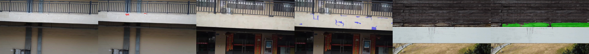
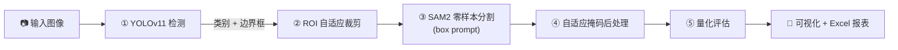
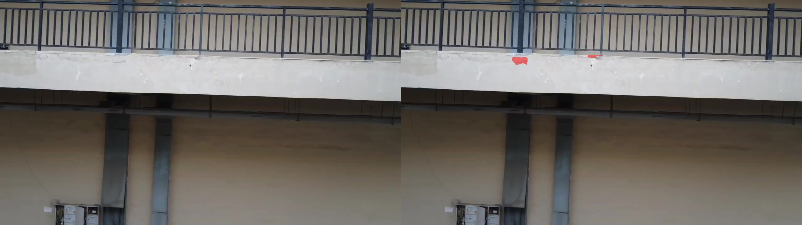
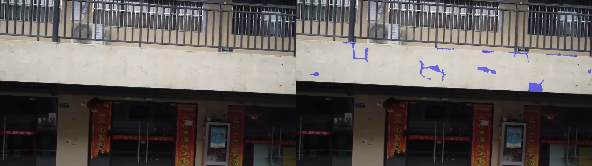
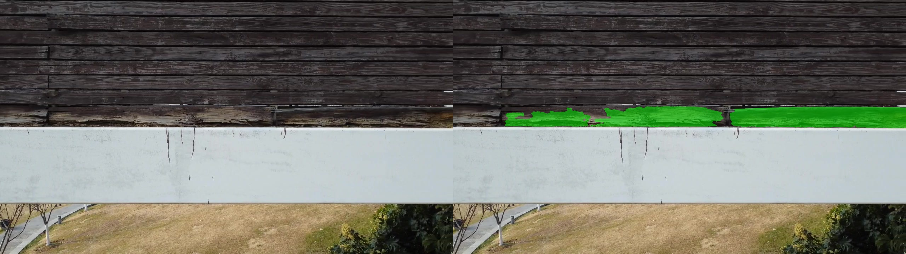

<div align="center">

# 🏫 校园设施损伤智能分割与量化评估系统

**YOLOv11 + SAM2 级联 · 校园病害检测 / 分割 / 量化评估**


面向校园**墙面剥落、地面裂缝、设施锈蚀**三类设施病害的端到端评估系统。
「检测 → 分割 → 量化 → 报表」全流程自动化，无需实拍数据、无需微调 SAM2。

</div>



---

## ✨ 功能亮点

- 🎯 **YOLOv11 前置检测**：轻量检测器定位缺陷（类别 + 边界框），为分割提供先验
- 🧩 **SAM2 零样本分割**：ROI 裁剪 + box prompt 像素级分割，**不微调**即可适配小目标/遮挡
- 🛠 **自适应掩码后处理**：面积过滤 / 孔洞填充 / 碎片剔除 / 形态学平滑
- 📊 **端到端量化**：像素面积 / 损伤占比 / 真实面积(mm²) / Excel 报表导出
- 🖥 **Streamlit Web 系统**：拖拽上传即用，一键启动

---

## 🧩 系统架构



**设计动机**：SAM2 对整图无提示分割会产出海量类无关掩码（Precision 仅 0.04），
必须由检测器提供「类别 + 位置」先验；检测器只出框、不分割，两者互补。
ROI 裁剪将分割限定在缺陷局部，既提升精度又降低计算量。

---

## 🚀 快速开始

> 无需数据集即可直接推理——训练好的 YOLO 权重已随仓库提交，只需补下载 SAM2 权重。

### 1. 克隆仓库

```bash
git clone https://github.com/Lzz417/campus-facility-damage-assessment.git
cd campus-facility-damage-assessment
```

### 2. 安装依赖（Python 3.11）

```bash
python -m venv .venv
# Windows: .venv\Scripts\activate   |   Linux/macOS: source .venv/bin/activate

# torch 需从 CUDA 源安装（RTX 30/40 系列 + CUDA 12.4）
pip install torch torchvision --index-url https://download.pytorch.org/whl/cu124
pip install -r requirements.txt
```

### 3. 下载模型权重

```bash
python scripts/download_models.py
# 国内网络可指定代理：python scripts/download_models.py --proxy http://127.0.0.1:10809
```

### 4. 一键启动 🎉

```bash
# Windows：双击 start_system.bat，或
streamlit run app/app.py
```

浏览器打开 `http://localhost:8501`，上传图片即可推理。

---

## 📊 实验结果

**评估集**：198 张人工复核 GT 掩码（分层抽样，测试集原始分布，无泄漏）

| 环节 | 模型/方案 | 关键指标 |
|------|----------|----------|
| 🎯 检测 | YOLOv11n（增强集 57,638 张） | mAP50 **0.858** / mAP50-95 0.451 |
| 🧩 分割 | 完整方案（级联 + 后处理） | mIoU **0.692** / Precision 0.835 / F1 0.818 / FPS 2.02 |

### 组件消融（2×2 因子设计）

| 分支 | 说明 | mIoU | Precision | Recall | F1 | FPS |
|------|------|------|-----------|--------|-----|-----|
| A | 原始 SAM2（无提示全图） | 0.037 | 0.038 | 0.666 | 0.072 | 0.70 |
| B | SAM2 + 后处理 | 0.039 | 0.040 | 0.653 | 0.075 | 0.70 |
| C | 级联（无后处理） | 0.670 | 0.800 | 0.805 | 0.803 | 2.04 |
| **D** | **完整方案** | **0.692** | **0.835** | **0.802** | **0.818** | **2.02** |

- 🏆 **级联价值**：mIoU 0.037 → 0.692（**约 18 倍**），推理提速 3×
- 🛠 **后处理价值**：Precision **+3.4**（剔除伪掩码/碎片）

### 数据消融（原集 vs 自研增强）

| 训练集 | 规模 | mAP50 | Recall | 级联 mIoU |
|--------|------|-------|--------|-----------|
| 原集（无增强） | 8,234 | 0.847 | 0.778 | 0.679 |
| **原集 + 增强** | **57,638** | **0.858** | **0.807** | **0.692** |

---

## 🖼 效果展示

> 左侧原图，右侧分割叠加（红=剥落、绿=裂缝、蓝=锈蚀）

| 墙面剥落 | 地面裂缝 | 设施锈蚀 |
|---------|---------|---------|
|  |  |  |

---

## 🗂 项目结构

```
campus-facility-damage-assessment/
├── app/                    # Streamlit Web 系统
├── configs/config.yaml     # 全局配置（类别/阈值/路径）
├── src/                    # 核心算法包
│   ├── detect.py           #   YOLOv11 检测 + ROI 裁剪
│   ├── segment.py          #   SAM2 分割
│   ├── postprocess.py      #   自适应掩码后处理
│   ├── quantify.py         #   面积/占比量化
│   ├── pipeline.py         #   端到端级联推理链
│   └── evaluate.py         #   mIoU/Precision/Recall/FPS
├── scripts/                # 数据管线（01→08 编号顺序执行）
├── train/train_yolo.py     # YOLOv11 训练
├── experiments/ablation.py # 消融对比实验
├── report/                 # 研究报告 + 演示脚本
├── weights/                # 模型权重（训练成果已提交，SAM2 需下载）
├── start_system.bat        # Windows 一键启动
└── requirements.txt
```

---

## 🔬 复现完整实验

数据管线（下载公开数据集 → 清洗重构 → 划分 → 退化增强 → 构建 GT）：

```bash
python scripts/01_download_datasets.py   # 下载 MBDD / CrackForest
python scripts/02_clean_dataset.py       # 清洗 + 3 类重构
python scripts/04_split_dataset.py       # 7:2:1 划分（seed=42）
python scripts/03_augment_dataset.py     # 自研 6 类退化增强（仅训练集）
python scripts/06_build_gt_masks.py      # 构建评估 GT 掩码
python train/train_yolo.py --data data/splits/data.yaml \
    --epochs 100 --batch 32 --imgsz 640 --device 0 --name train_aug
python experiments/ablation.py           # 组件消融 A/B/C/D
```

> 全部增强算子（暗光/逆光/雾/阴影/遮挡/模糊）为纯 OpenCV/NumPy 自研实现，
> 非第三方增强库，保证标注一致性与可复现性。

---

## 🙏 致谢与数据来源

- 检测数据：**MBDD** 公开病害数据集（bbox 标注，经清洗重分类为 3 类）
- 分割基座：**SAM2**（Meta, Segment Anything 2, 零样本，未微调）
- 检测基座：**YOLOv11n**（Ultralytics）

## 📄 许可证

[MIT](LICENSE) © 2026 Lzz417

---

<div align="center">
<i>面向「挑战杯」校园智慧巡检应用 · 无实拍数据域适配 · 可量化、可落地</i>
</div>
