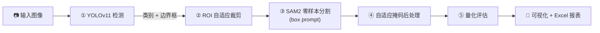

<div align="center">

# 🏫 校园设施损伤智能分割与量化评估系统

**YOLOv11 + SAM2 级联 · 校园病害检测 / 分割 / 量化评估**


面向校园**墙面剥落、地面裂缝、设施锈蚀**三类设施病害的端到端评估系统。
「检测 → 分割 → 量化 → 报表」全流程自动化，无需实拍数据、无需微调 SAM2。

</div>


> 顶部展示图使用 `assets/demo_peeling.jpg`（本项目自制的"原图 ｜ 分割叠加"对比图，
> 原图来自 **MBDD2025**，CC BY 4.0，署名见 [THIRD_PARTY_NOTICES.md](THIRD_PARTY_NOTICES.md)）。
> 原先的 `assets/banner.jpg` 因**来源无法确认**已移除（不承担版权风险），
> 后续替换图将只使用本项目自制的图 / Web UI 截图 / 自绘架构示意图 / 许可证明确且已署名者。

---

## 📌 Project Status

| 项 | 状态 |
|---|---|
| V2 严格留出评价（split_v2） | **CLOSED**（evidence frozen，不再改动） |
| V3 域适配实验 | **CLOSED**（evidence frozen，不再改动） |
| Web demo 实现 | **SYNCHRONIZED AFTER EVALUATION**（工程同步，非重新评价） |
| 新增性能证据 | **NONE** |

```
Scientific evaluation: FROZEN / UNCHANGED
Demo implementation:   SYNCHRONIZED AFTER EVALUATION
New performance evidence: NONE
```

> **本项目自有的代码与文档按 AGPL-3.0 发布；第三方组件（Ultralytics YOLO、Meta SAM 2、数据集）
> 继续受各自许可证约束。** 详见 [LICENSE](LICENSE) 与 [THIRD_PARTY_NOTICES.md](THIRD_PARTY_NOTICES.md)。

## 🔎 Key Findings

- **V2 严格留出评价（split_v2 test）**：`mAP50 = 0.1632`。
- **V3 同来源留出比较（Smart Campus 来源 test）**：V2 baseline `mAP50 = 0.0353` → V3 adapted `mAP50 = 0.6533`。
- **MBDD 旧域验证**：`0.1185 → 0.1064`，相对变化 **−10.2%**（仍在预登记的 forgetting guard 内）。

**必须与上面三条一起读的边界**：

1. Smart Campus 的 train / val / test **来自同一个公开数据来源**（同一数据集、同一次采集）；
2. 因此 V3 的结果证明的是**针对该来源进行适配的效果**，**不证明**在未知校园或其它独立来源上的泛化；
3. 该数据集页面**没有公开采集地点/方法**，所以**不能**断言其实际采自校园；
4. V3 **只重新验证了 detector**，**没有**重新评价 SAM2 的像素级分割性能。

全部允许使用的数字见 [docs/methodology/report_numbers_table_public.csv](docs/methodology/report_numbers_table_public.csv)。

> All numbers shown in this README are taken from
> `docs/methodology/report_numbers_table_public.csv`,
> a public derived summary compiled from frozen V2/V3 evidence.
> The original frozen evidence files remain unchanged.

## 🧪 Methodological Contributions

1. **近重复泄漏审计与受控评价**：发现并量化了原随机划分中的同源近重复泄漏，改为按约束组划分的严格留出评价。
2. **数据治理 + 带 forgetting guard 的来源特化适配**：对新来源做污染审计与清洗（含剔除第三方水印素材、AI 生成图、实验室试片），
   并以"新来源提升"为主目标、同时用预登记的遗忘阈值约束旧域退化。
3. **YOLO11 → SAM2 级联的误差诊断**：定位检测器为级联链的主要瓶颈，并区分"检测漏检"与"分割质量"两类误差来源。

> 以上属于**数据治理、评价方法与实验设计**层面的贡献，**不是**新的基础网络结构。

## ✨ 功能亮点

- 🎯 **YOLOv11 前置检测**：轻量检测器定位缺陷（类别 + 边界框），为分割提供先验
- 🧩 **SAM2 零样本分割**：ROI 裁剪 + box prompt 像素级分割，**不微调**即可适配小目标/遮挡
- 📐 **逐类可调 box 提示（实验项，默认关闭）**：支持按类扩张/收缩 SAM2 框提示；实测面病害扩张会引发掩码过分割（198 张 GT 上 mIoU 0.692→0.331），故默认关闭，作为调参选项保留
- 🛠 **自适应掩码后处理**：面积过滤 / 孔洞填充 / 碎片剔除 / 形态学平滑（细裂缝仅闭运算防抹除）
- 📊 **端到端量化**：像素面积 / 损伤占比 / 真实面积(mm²) / Excel 报表导出
- 🖥 **Streamlit Web 系统**：拖拽上传即用，一键启动

---

## 🧩 系统架构



**设计动机**：SAM2 对整图无提示分割会产出海量类无关掩码（Precision 仅 0.04），
必须由检测器提供「类别 + 位置」先验；检测器只出框、不分割，两者互补。
ROI 裁剪将分割限定在缺陷局部，既提升精度又降低计算量。

---

## 🚀 快速开始

> 无需数据集即可直接推理——训练好的 YOLO 权重已随仓库提交，只需补下载 SAM2 权重。

### 1. 克隆仓库

```bash
git clone https://github.com/Lzz417/campus-facility-damage-assessment.git
cd campus-facility-damage-assessment
```

### 2. 安装依赖（Python 3.11）

```bash
python -m venv .venv
# Windows: .venv\Scripts\activate   |   Linux/macOS: source .venv/bin/activate

# torch 需从 CUDA 源安装（RTX 30/40 系列 + CUDA 12.4）
pip install torch torchvision --index-url https://download.pytorch.org/whl/cu124
pip install -r requirements.txt
```

### 3. 下载模型权重

```bash
python scripts/download_models.py
# 国内网络可指定代理：python scripts/download_models.py --proxy http://127.0.0.1:10809
```

### 4. 一键启动 🎉

```bash
# Windows：双击 start_system.bat，或
streamlit run app/app.py
```

浏览器打开 `http://localhost:8501`，上传图片即可推理。

---

## 🧭 Demo vs Evaluation

Web demo 与冻结评价链路的处理口径**已经对齐**，但两者用途不同，必须区分：

| | 历史实验/复现 | Web demo |
|---|---|---|
| 入口 | `experiments/`、`scripts/` 中的历史脚本 | `app/app.py` |
| `src/pipeline.py` 的 `frozen_compat` | **默认 `False`（保持历史行为）** | **显式传 `True`** |
| 目的 | 复现已记录的历史实验结果 | 与 V2 冻结评价口径一致 |

- `frozen_compat=False`（默认）：ROI 以 BGR 原样送入 SAM2；跨类冲突**低 conf 胜**——**历史行为，保持不变**，
  以免历史脚本重跑时与已记录的 `experiments/ablation*.csv` 不可比。
- `frozen_compat=True`（仅 demo）：送 SAM2 前显式 **BGR→RGB**；跨类冲突**高 conf 胜**；demo 默认**置信度 0.075**（冻结工作点）。
- 无检测结果时界面与报表统一显示 **「未检出目标」**（**不写**"无缺陷"——模型未检出 ≠ 实际不存在缺陷）。

> ⚠️ 本次 demo 同步是**工程实现一致化**，**不是**新的实验结果：
> 没有重跑评价、没有产生任何新的性能数字。
> 详见 [docs/demo_sync/CHANGELOG.md](docs/demo_sync/CHANGELOG.md)。

---

## 📊 实验结果

> ⚠️ **本节数字来自 split_v2 之前的旧随机划分**，用于记录当时的消融结论。
> 该划分后来被证明存在**同源近重复泄漏**，因此**这些数字不可与严格留出结果直接比较**。
> 当前有效的严格评价结论见上方 **Key Findings**。

**评估集**：198 张人工复核 GT 掩码（分层抽样，测试集原始分布，无泄漏）

| 环节 | 模型/方案 | 关键指标 |
|------|----------|----------|
| 🎯 检测 | YOLOv11n（增强集 57,638 张） | mAP50 **0.858** / mAP50-95 0.451 |
| 🧩 分割 | 完整方案（级联 + 后处理） | mIoU **0.692** / Precision 0.835 / F1 0.818 / FPS 2.02 |

### 组件消融（2×2 因子设计）

| 分支 | 说明 | mIoU | Precision | Recall | F1 | FPS |
|------|------|------|-----------|--------|-----|-----|
| A | 原始 SAM2（无提示全图） | 0.037 | 0.038 | 0.666 | 0.072 | 0.70 |
| B | SAM2 + 后处理 | 0.039 | 0.040 | 0.653 | 0.075 | 0.70 |
| C | 级联（无后处理） | 0.670 | 0.800 | 0.805 | 0.803 | 2.04 |
| **D** | **完整方案** | **0.692** | **0.835** | **0.802** | **0.818** | **2.02** |

- 🏆 **级联价值**：mIoU 0.037 → 0.692（**约 18 倍**），推理提速 3×
- 🛠 **后处理价值**：Precision **+3.4**（剔除伪掩码/碎片）

### 数据消融（原集 vs 自研增强）

| 训练集 | 规模 | mAP50 | Recall | 级联 mIoU |
|--------|------|-------|--------|-----------|
| 原集（无增强） | 8,234 | 0.847 | 0.778 | 0.679 |
| **原集 + 增强** | **57,638** | **0.858** | **0.807** | **0.692** |

---

## 🖼 效果展示

> 左侧原图，右侧分割叠加（红=剥落、绿=裂缝、蓝=锈蚀）

| 墙面剥落 | 地面裂缝 | 设施锈蚀 |
|---------|---------|---------|
|  |  |  |

---

## 🗂 项目结构

```
campus-facility-damage-assessment/
├── app/                    # Streamlit Web 系统
├── configs/config.yaml     # 全局配置（类别/阈值/路径）
├── src/                    # 核心算法包
│   ├── detect.py           #   YOLOv11 检测 + ROI 裁剪
│   ├── segment.py          #   SAM2 分割
│   ├── postprocess.py      #   自适应掩码后处理
│   ├── quantify.py         #   面积/占比量化
│   ├── pipeline.py         #   端到端级联推理链
│   └── evaluate.py         #   mIoU/Precision/Recall/FPS
├── scripts/                # 数据管线（01→08 编号顺序执行）
├── train/train_yolo.py     # YOLOv11 训练
├── experiments/ablation.py # 消融对比实验
├── report/                 # 研究报告 + 演示脚本
├── weights/                # 模型权重（用途/SHA256/许可见 weights/README.md）
├── start_system.bat        # Windows 一键启动
└── requirements.txt
```

---

## 🔬 复现完整实验

数据管线（下载公开数据集 → 清洗重构 → 划分 → 退化增强 → 构建 GT）：

```bash
python scripts/01_download_datasets.py   # 下载 MBDD / CrackForest
python scripts/02_clean_dataset.py       # 清洗 + 3 类重构
python scripts/04_split_dataset.py       # 7:2:1 划分（seed=42）
python scripts/03_augment_dataset.py     # 自研 6 类退化增强（仅训练集）
python scripts/06_build_gt_masks.py      # 构建评估 GT 掩码
python train/train_yolo.py --data data/splits/data.yaml \
    --epochs 100 --batch 32 --imgsz 640 --device 0 --name train_aug
python experiments/ablation.py           # 组件消融 A/B/C/D
```

> 全部增强算子（暗光/逆光/雾/阴影/遮挡/模糊）为纯 OpenCV/NumPy 自研实现，
> 非第三方增强库，保证标注一致性与可复现性。

---

## ♻️ Reproducibility

- **环境**：Python 3.11 / PyTorch 2.6（CUDA 12.4）/ Ultralytics / SAM2 / Streamlit；完整依赖见 [requirements.txt](requirements.txt)。
- **权重准备**：仓库内**只包含两个历史 YOLO 权重**；SAM2 检查点、yolo11n 预训练权重、
  以及 V2/V3 的训练产物**均不在仓库中**，需自行获取。
  **各自的位置、SHA256、用途与许可见 [weights/README.md](weights/README.md)。**
- **数据准备**：MBDD2025 等原始数据集**不随仓库分发**，请按 [scripts/](scripts/) 中的编号脚本
  自行下载与构建；V3 使用的第二数据来源**只发布来源说明、清洗方法与统计结果，不重新分发其图片**。
- **V3 方法学脚本**：见 [scripts/v3/](scripts/v3/)（划分构建、训练、双域评价、checkpoint 选择、
  阈值选择、最终 test 比较）。这些脚本**不会自动执行 test**，解封 test 需显式授权。
- **研究过程文档**：[docs/methodology/](docs/methodology/) 与 [docs/protocols/](docs/protocols/)
  （含预登记的模型选择协议与 test 比较协议）。

## 📄 许可证

本项目**自有代码与文档**按 **[AGPL-3.0](LICENSE)** 发布。

```
Copyright (C) 2026 Lzz417
```

**第三方组件继续受其各自许可证约束**，不因本项目采用 AGPL-3.0 而改变：

| 组件 | 许可证 |
|---|---|
| Ultralytics YOLO11（含本仓库发布的、基于其训练的权重） | **AGPL-3.0** |
| Meta SAM 2 | Apache-2.0 |
| MBDD2025 数据集 | CC BY 4.0（署名） |

完整声明（含数据来源与 `assets/` 图像的署名要求）见 [THIRD_PARTY_NOTICES.md](THIRD_PARTY_NOTICES.md)。

## ⚠️ Limitations

1. **数据来源未核实**：V3 使用的第二数据来源只标注 "Provided by a Roboflow user"，
   **没有公开采集地点与采集方法**，因此本仓库**不**称其为"已证实的真实校园数据"。
2. **同源**：V3 的 train / val / test 来自**同一数据来源的同一次采集**，
   故其结果只证明"对该来源的适配效果"，**不证明**对未知校园或其它独立来源的泛化。
3. **无独立外部来源验证**：本轮没有引入任何独立的外部测试来源。
4. **只验证检测器**：V3 **只重新验证了 detector**，**没有**重新评价 SAM2 的像素级分割性能；
   分割结论仍来自此前的参考集评价，不随 V3 改变。
5. **类别映射**由 AI 辅助视觉审计提出、按保守数据治理原则批准，且对污染最重的类别剔除了约 57% 的样本。
6. **小样本**：V3 的 held-out test 规模较小（单一来源、单一光照条件）。
7. **研究原型**：本系统是研究原型，**不是**结构安全评估系统，输出**不能**用于工程安全性判定。

## 🙏 致谢与数据来源

- 检测数据：**MBDD2025** 公开病害数据集（CC BY 4.0，bbox 标注，经清洗重分类为 3 类）
- 第二数据来源：**Smart Campus Dataset**（Roboflow Universe；来源说明与清洗方法见
  [docs/methodology/](docs/methodology/)，本项目**不重新分发其原始图片**）
- 分割基座：**SAM2**（Meta, Segment Anything 2, 零样本，未微调）
- 检测基座：**YOLOv11n**（Ultralytics，AGPL-3.0）

---

<div align="center">
<i>面向「挑战杯」校园智慧巡检应用 · 无实拍数据域适配 · 可量化、可落地</i>
</div>
